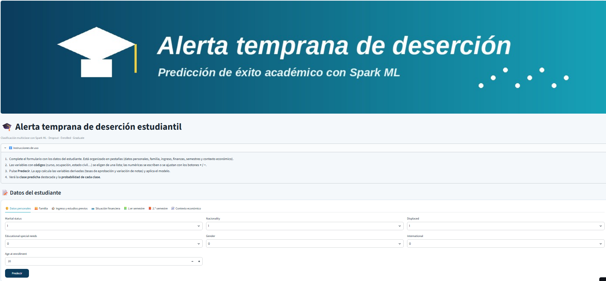
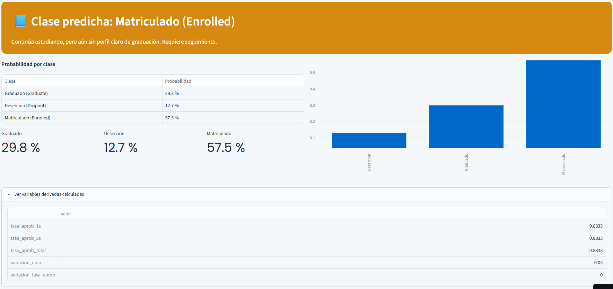
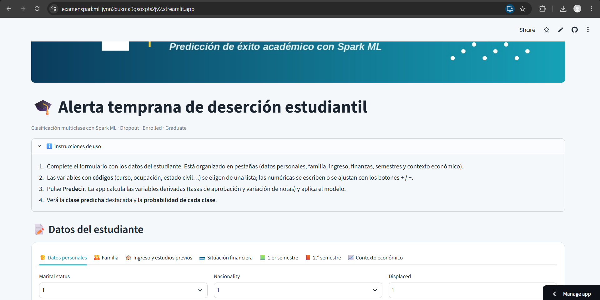

# 🎓 Alerta temprana de deserción estudiantil (Spark ML + Streamlit)

Aplicación web que clasifica a un estudiante en **Dropout**, **Enrolled** o **Graduate** usando un
`PipelineModel` de **Spark ML** entrenado con el dataset *Predict Students' Dropout and Academic Success* (Kaggle).

**🔗 App desplegada:** <https://examensparkml-jynn2xuxma9gsoxpts2jv2.streamlit.app>

**Autor:** TU NOMBRE COMPLETO · Examen Big Data – Spark ML (Parte 2)

## Contenido del repositorio
| Archivo | Descripción |
|---|---|
| `app.py` | App de Streamlit (formulario, variables derivadas, predicción y probabilidades) |
| `modelo_final/` | `PipelineModel` completo + `labels.json` (orden de clases) + `meta.json` (campos del formulario) |
| `banner.png` | Imagen de cabecera de la app |
| `capturas/` | Capturas de pantalla de la app funcionando |
| `requirements.txt` | `streamlit`, `pyspark==3.5.1`, `pandas` |
| `packages.txt` | `default-jre` (Java, requerido por Spark) |
| `examen_spark_ml.ipynb` | Notebook ejecutado: carga, limpieza, features, pipelines, CV, evaluación |

## Capturas de la app funcionando

**Formulario de entrada** (título, banner, instrucciones de uso y pestañas con todas las variables del modelo):



**Resultado al pulsar Predecir** (clase predicha destacada, probabilidad por clase en tabla y gráfico, y variables derivadas calculadas):



**App desplegada en Streamlit Community Cloud** (URL pública en el navegador):



## Modelo
Pipeline: `StringIndexer → OneHotEncoder → VectorAssembler → StandardScaler → clasificador`.
Se compararon regresión logística multinomial, Random Forest y árbol de decisión (CrossValidator, 3 folds, F1 ponderado).
El desbalance de clases se trató con pesos por clase (`weightCol`). Variables derivadas: tasas de aprobación por semestre
y total, variación de notas y variación de la tasa de aprobación.

## Cómo ejecutarla localmente
```bash
# Requiere Java 11 o 17 instalado
pip install -r requirements.txt
streamlit run app.py
```

## Cómo desplegarla en Streamlit Community Cloud
1. Subir a GitHub: `app.py`, `modelo_final/`, `banner.png`, `capturas/`, `requirements.txt`, `packages.txt`, `README.md` (y `.streamlit/config.toml`).
2. En <https://share.streamlit.io> → **Create app** → elegir el repo, rama y `app.py`.
3. En **Advanced settings** elegir Python 3.11 (o 3.12) → **Deploy**.
4. Copiar la URL pública en este README.

> La primera carga tarda ~1 minuto porque se inicia Spark y se carga el modelo (`@st.cache_resource` lo mantiene en memoria después).
